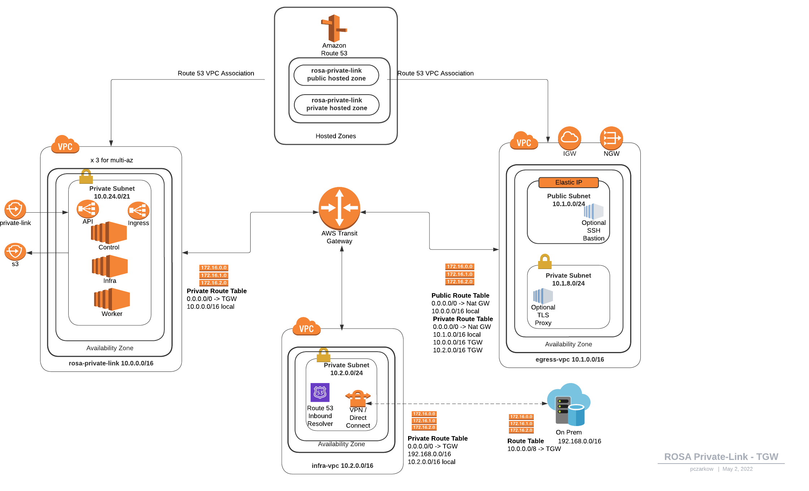

# ansible-rosa


  This project is provided as-is, and is not an official or
  Supported Red Hat project. We will happily accept issues and
  Pull Requests and provide basic OSS level community support

***

This project contains a set of modules for working with ROSA as well as some example playbooks.

Will create/delete ROSA clusters but if you know how to work ansible inventories, it can do multiple clusters.

The repository has a number of example scenarious that are configured as Ansible Inventories found in the `environment` folder.  The `default` environment will provision a single-az public cluster on a BYO VPC cluster. These can be selected by using `make` as such

Examples

* `make create` - default single-az classic cluster.
* `make create.hcp` - hosted control plane cluster.
* `make create.pl` - private-link classic cluster.
* `make create.tgw` - private-link classic cluster with TransitGateway.


## Examples using ROSA Ansible Modules

Module reference (OCM and `rosa_*` wrappers, AWS helpers): [docs/modules.md](docs/modules.md). Per-module help after `make virtualenv`: `./virtualenv/bin/ansible-doc rh_mobb.rosa.<module_name>`.

## Prerequisites

1. **Python 3.11 or newer** on the control host (required by [ocm-python](https://github.com/rh-mobb/ocm-python) 0.4.0 OCM modules).

1. Create a [Red Hat](https://cloud.redhat.com) account, if you do not already have one. Then, check your email for a verification link. You will need these credentials to install ROSA.

1. Download and install the [AWS cli](https://aws.amazon.com/cli/)

1. Download and install the [ROSA cli](https://console.redhat.com/openshift/downloads)

1. Enable the ROSA service in AWS.

    1. Sign in to your AWS account.
    1. Go to the [ROSA service](https://console.aws.amazon.com/rosa/) and select **Enable**.

## Log in to AWS and ROSA

To authenticate to AWS / ROSA you can use the tools directly to auth or set ansible variables and let it do it for you.

### Login First

1. Configure aws cli

    ```bash
    aws configure
    ```

2. Configure rosa

    ```bash
    rosa login
    ```

## Prepare Ansible

### Install only the collection (from Ansible Galaxy)

```bash
ansible-galaxy collection install rh_mobb.rosa
```

Galaxy installs dependent collections (`amazon.aws`, `community.aws`) automatically. You still need **Python 3.11+** on the control host and the Python libraries OCM modules use—either clone this repo and run `make virtualenv`, or install from the copy shipped inside the collection:

```bash
COLLECTION_PATH="$(ansible-config dump | awk -F= '/COLLECTIONS_PATHS/{print $2}' | awk '{print $1}')"
pip3 install -r "${COLLECTION_PATH%/}/ansible_collections/rh_mobb/rosa/requirements.txt"
```

Configure AWS and OCM/ROSA credentials as usual (`aws configure`, `rosa login`, or equivalent environment variables).

### Clone the repo (playbooks and example inventories)

```bash
git clone https://github.com/rh-mobb/ansible-rosa.git
cd ansible-rosa
```

Create the local virtualenv (Ansible, Galaxy collections from `requirements.yml`, and Python deps):

```bash
make virtualenv
```

### If you encounter SSL Certificate errors with ansible-galaxy and want to bypass certificate validation. USE WITH CAUTION!

```
IGNORE_CERTS=true make virtualenv
```

## Deploy a Cluster

### Basic STS single AZ cluster

This will deploy a single-az cluster with STS enabled.

> See `./environment/default/group_vars/all.yaml` for the example inventory used. You can modify this file to change the cluster configuration.

* Create:

```bash
make create
```

* Delete:

```bash
make delete
```

### PrivateLink Cluster with Transit Gateway

> See `./environment/transit-gatewa-egress/group_vars/all.yaml` for the example inventory used. You can modify this file to change the cluster configuration.

This will deploy a **fairly** complex cluster with STS enabled, Transit Gateway, and PrivateLink. Along with the ROSA VPC it will create an Egress VPC with a NAT Gateway and a Squid based proxy (configured to restrict cluster egress to just the allowed endpoints). It places a SSH Bastion in the Egress VPC in order to provide easy access to the cluster (sshuttle ftw). It also creates an infrastructure VPC which is where you might connect your Datacenter or VPN connections too, this has a DNS forwarder to help with DNS resolution.



* Create:

```bash
make create.tgw
```

* Delete:

```bash
make delete.tgw
```

### PrivateLink Cluster with BYOK (KMS)

>See `./environment/private-link/group_vars/all.yaml` for the example inventory used.

Setting the variable 'rosa_kms_key_arn' to a kms arn, will execute the procedure found [here](https://mobb.ninja/docs/rosa/kms/)


## Other

### Deploy a Cluster with ansible in a Podman container

Requires [Podman](https://podman.io/) on the control host. Images build from the repo [Dockerfile](Dockerfile).

1. Build the container image

    ```bash
    make image
    ```

2. Create the cluster (do *one* of the following)

    * If you've already logged in locally:

    ```bash
    make podman.create
    ```

    * If you want to let ansible log you in (fill out the variables):

    ```bash
    podman run --rm -ti -e AWS_ACCESS_KEY_ID="" \
       -e AWS_SECRET_ACCESS_KEY="" -e ROSA_TOKEN="" \
       quay.io/pczar/ansible-rosa \
       ansible-playbook create-cluster.yaml
    ```

3. Delete the cluster

    ```bash
    make podman.delete
    ```

    or

    ```bash
    podman run --rm -ti -e AWS_ACCESS_KEY_ID="" \
       -e AWS_SECRET_ACCESS_KEY="" -e ROSA_TOKEN="" \
       quay.io/pczar/ansible-rosa \
       ansible-playbook delete-cluster.yaml
    ```


### ToDos

#### Add custom domain support

* https://access.redhat.com/articles/5599621
* https://github.com/openshift/custom-domains-operator/blob/master/TESTING.md
